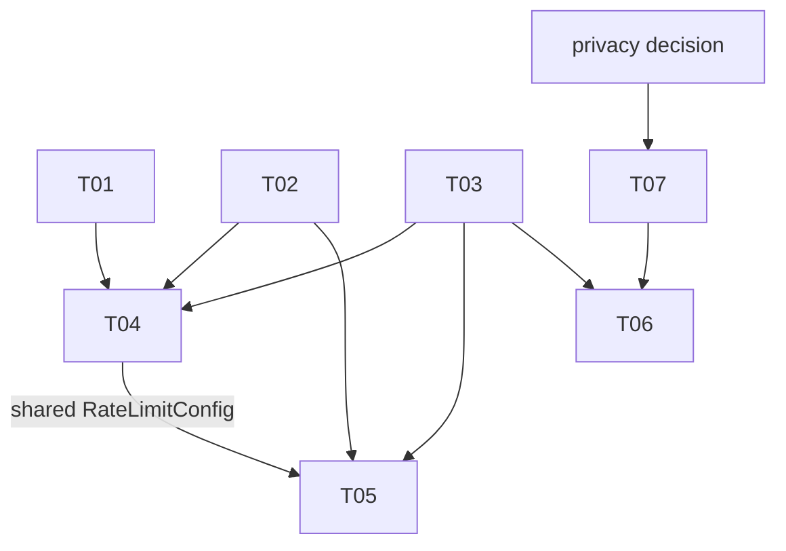

# Tickets: api-traffic-protection

Sprint-sized slices of the accepted PRD and spec (2026-10-19; spec amended
2026-10-21, see T02). Markdown only; no GitHub issues. Crew agents also read
`../prime-shared.md` and their `../prime-T<nn>.md`.

| ID | Title | Size | Depends |
|----|-------|------|---------|
| [T01](T01-request-id-filter-order.md) | Explicit order on RequestIdFilter | S | none |
| [T02](T02-token-bucket-store.md) | Token bucket and bucket store | M | none |
| [T03](T03-rate-limit-properties.md) | Rate-limit configuration properties | S | none |
| [T04](T04-rate-limit-filter.md) | Rate-limit filter, 429 and throttle log | M | T01, T02, T03 |
| [T05](T05-idle-sweep-and-key-cap.md) | Idle-bucket sweep and key cap | S | T02, T03, T04 |
| [T06](T06-limit-values-from-baseline.md) | Limit values from the ops baseline | S | T03, T07 |
| [T07](T07-traffic-baseline-access-log.md) | Traffic data for the baseline (draft) | S | privacy |

## Dependency graph

## Waves

- Wave 1 (parallel, no shared files): T01, T02, T03.
- Wave 2 (**sequential**): T04, then T05. Both edit the shared file
  `RateLimitConfig.java`, which T04 creates. T05 also edits `BucketStore.java`,
  which T04 only calls. The full list is under "Shared files" in
  `../prime-shared.md`.
- Wave 3: T06, once T03 is implemented and the T07 data has given ops a baseline.
  Until then the generous placeholder limits from T03 stay in place.
- T07 is a draft outside the waves, with the owner TBD. It does not block T01-T05.
