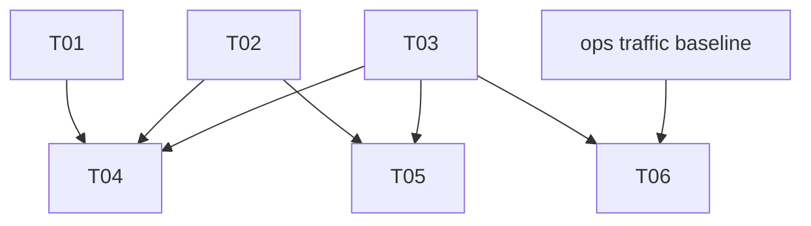

# Tickets: api-traffic-protection

Sprint-sized slices of the accepted PRD and spec (2026-10-19). Markdown only; no
GitHub issues.

| ID | Title | Size | Depends |
|----|-------|------|---------|
| [T01](T01-request-id-filter-order.md) | Explicit order on RequestIdFilter | S | none |
| [T02](T02-token-bucket-store.md) | Token bucket and bucket store | M | none |
| [T03](T03-rate-limit-properties.md) | Rate-limit configuration properties | S | none |
| [T04](T04-rate-limit-filter.md) | Rate-limit filter, 429 and throttle log | M | T01, T02, T03 |
| [T05](T05-idle-sweep-and-key-cap.md) | Idle-bucket sweep and key cap | S | T02, T03 |
| [T06](T06-limit-values-from-baseline.md) | Limit values from the ops baseline | S | T03, ops |

## Dependency graph

## Waves

- Wave 1 (parallel, no shared files): T01, T02, T03.
- Wave 2 (parallel once wave 1 is implemented): T04, T05. T05 edits
  `BucketStore.java`, which T04 only calls; if both end up changing it, serialize
  them or give each a worktree.
- Wave 3: T06, once T03 is implemented and ops has delivered the baseline. Until
  then the generous placeholder limits from T03 stay in place.
